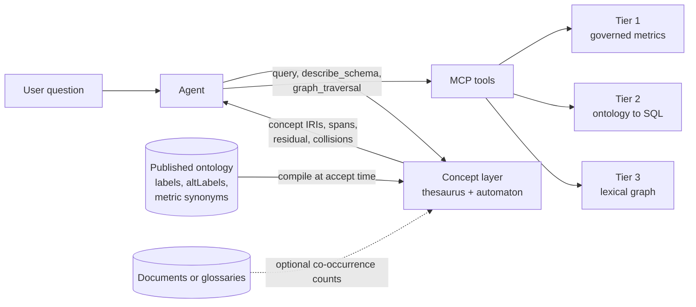

+++
title = "A Deterministic Concept Layer beside an Ontology and a Lexical Graph"
description = "Agents that query a governed semantic layer need to know which concept a user means before they ask. Using AWS's Context Ontology Accelerator as the reference point, this paper places a thesaurus-and-automaton layer beside a formal ontology and a document lexical graph, and states what it may and may not decide."
date = 2026-11-27

[taxonomies]
categories = ["Architecture"]
tags = ["knowledge-graphs", "ontology", "semantic-layer", "terraphim", "ai-agents", "mcp"]

[extra]
archived = false
mermaid = true
+++

## Abstract

A semantic context layer for agents must turn a user's words into the concepts its data is organised by. AWS's Context Ontology Accelerator (COA, version 0.3.11) does this with two techniques. A formal ontology induced from tables, with R2RML mappings, serves governed metrics and ontology-guided SQL. A lexical knowledge graph extracted from documents serves retrieval and synthesis. Its documentation names the gaps between them, in particular:

- no exact lookup from a business variant to its class;
- grounding links between the table side and the graph side that are kept but not followed;
- a default retrieval path that does not read the formal ontology.

This paper proposes a third component beside the two: a deterministic concept layer. It compiles the ontology's own vocabulary into a thesaurus and matches it with a single automaton. Optionally, it counts concept co-occurrence across documents. The paper assigns the layer four permitted decisions and three forbidden ones, and illustrates the mechanism on Terraphim's implementation. It reports where that implementation is weaker than COA's existing matcher. Nothing here has been measured against a COA deployment.

## The decision an agent makes before it asks

[Typed Relations, Counted Adjacency and Learned Scores](/posts/typed-relations-counted-adjacency-learned-scores/) argued that every edge in an agent's graph should carry its provenance: declared, counted or inferred. This paper takes up an earlier step in the same pipeline.

Before an agent queries a governed layer, it must decide which concept the user means. That decision has three possible owners:

1. **The semantic layer's model.** It embeds the question and lets retrieval and an LLM choose.
2. **A deterministic matcher.** It maps exact surface forms to concepts from a reviewed vocabulary.
3. **The agent's own model.** It guesses from schema descriptions it has fetched.

The first is flexible but not recomputable. The third spends round trips and context. The second can be recomputed and explained, but it covers only the vocabulary someone wrote down. The architecture question is how to combine them so that each decides only what it can justify.

## Reference point: a governed semantic layer

COA runs in the customer's AWS account and is organised as Scan, Model, Metrics and Serve. The facts below are read from its repository at commit `5dd33d7`.

**Technique one: a formal ontology from tables.**

- Discovery reads table and column metadata, and an LLM enriches it with descriptions and synonyms. A steward then approves it.
- Induction proposes OWL classes with R2RML mappings. Ontop can therefore translate SPARQL over those classes into SQL.
- Grounding aligns new classes with a foundational ontology. The `STANDARD` mode uses exact names and embedding thresholds. The default `ENHANCED` mode adds an LLM reranker that rejects same-name, different-meaning matches.
- Classes that are the target of an R2RML mapping are "mapped", and they are the normal input to structured queries. There are two bounded exceptions. When a namespace has no mapped class, NL to SQL searches the classes of uploaded user ontologies instead. An uploaded class can also be bound to an RDF/SPARQL graph source.

**Technique two: a lexical graph from documents.**

- Text extraction feeds a GraphRAG build. An LLM extracts entities, topics and statements into Neptune, and embeddings go to OpenSearch, scoped per namespace.
- An unstructured induction strategy can generalise this graph into OWL classes and SKOS concepts. Those classes have no table behind them.

**Serving.** Resolution runs in three tiers, each falling through to the next.

- **Tier 1** matches a governed metric by name or synonym, using one compiled pattern per name, with a fuzzy fallback at a similarity of 0.88. It declines when more than one metric matches. A residual-qualifier gate also declines when words outside the match and a closed stop-word list remain, and forwards the metric's formula to Tier 2 as authoritative context.
- **Tier 2** generates SQL or SPARQL over mapped classes and graph-bound classes. When a namespace has no mapped class, its NL to SQL path can use classes from uploaded user ontologies instead.
- **Tier 3** retrieves from the lexical graph and synthesises an answer.

Cedar authorisation, evaluated against the delegating user and failing closed, admits or refuses every MCP tool call. A SELECT-only SQL firewall adds per-user table and column controls on the Tier 1 and Tier 2 paths that execute SQL. Ontology schema is itself governed: the MCP server withholds schema fields from a caller without the `viewOntology` right. Agents reach all of this through six MCP tools.

**The documented gaps.** COA's documentation states them directly:

- accepted `skos:altLabel` variants are embedded and passed to the model as synonyms, but "there is no exact lookup from a variant to its class yet";
- a grounding link between an induced class and a graph-source class is kept, "but neither engine follows it". In the default standard cascade one tier answers each question. An optional `deep-reasoning` planner can combine structured and document evidence, but it bypasses the governed metrics;
- the default Tier 3 strategy uses topic and entity nodes "extracted from documents at ingestion, not the accepted, formally-typed ontology";
- the document-to-table bridge considers at most 60 tables by default, "the first in name order".

## The proposed layer

The concept layer is compiled, not trained. Its input is the vocabulary the governed layer already publishes:

- class labels and `altLabels`, from the graph vertex API or the ontology Turtle;
- metric names and their `aiContext.synonyms`.

Each surface form becomes a thesaurus key. Its value is the concept, with the class or metric IRI as its link. One automaton matches all keys in one pass and prefers the longest match. Every hit is returned with the matched term, its byte span and the concept.

The layer runs where the agent runs, or as a build step at the moment a steward accepts a proposal. It holds no rows or documents, but its vocabulary is governed information in its own right. It falls under two different rights. Class labels need `viewOntology`: `describe_schema` is refused without it. Metric names and `aiContext.synonyms` come from `list_metrics`, which is admitted with the namespace view right. There, `viewSource` controls a metric's SQL and source table, and `viewOntology` controls only its linked ontology concepts. The layer must therefore be compiled through those interfaces, as the user the agent acts for, with each part of the vocabulary following its own right. Each part must be scoped to that user and namespace, and rebuilt when the grants governing it or the accepted vocabulary change. Otherwise a local index would keep vocabulary that the caller may no longer see.

### Permitted decisions

1. **Name the concept.** It maps a surface form to a class or metric IRI exactly. On the agent side this fills the documented variant gap. The agent can then narrow its schema request to the classes it needs.
2. **Report the residual.** It returns the parts of the question that no match covered. This is the same signal COA's Tier 1 computes internally. Exposing it lets the agent ask the user a follow-up, or pass a qualifier through the metric's supported dimensions, before it spends a query.
3. **Lint the vocabulary.** It fails the compile when one surface form belongs to two concepts. COA declines such a match at run time. Catching it when the proposal is accepted moves the fix to the steward, who can make it, and away from every agent that would otherwise meet the decline.
4. **Propose candidates.** Counted co-occurrence between a document concept and a column concept, within one paragraph, nominates tables for the bridge to read first. It can also seed graph traversal with an exact entity next to the vector hit.

### Forbidden decisions

1. **Asserting equivalence across sides.** A co-occurrence count is not a `skos:closeMatch`. Only the governed layer's reviewed alignment may assert one.
2. **Answering.** The layer never returns a number or a fact, only concepts and spans. The tiers answer, behind Cedar admission and, where SQL runs, the firewall.
3. **Overriding a decline.** If the governed layer declines an ambiguous match, the agent may not resubmit with a guessed concept pinned. The concept layer resolves wording, not ambiguity in the vocabulary.

## Illustration on an existing implementation

Terraphim's `terraphim_automata` and `terraphim_rolegraph` crates implement the mechanism. We ran a small program against terraphim-core at commit `b1f8389`, with a hand-made vocabulary that mirrors COA's documentation examples:

- a churn class labelled `解約` with the variant `顧客離脱`;
- two metrics that deliberately share the synonym `revenue`;
- an `order_status` column.

We wrote one glossary sentence that mentions a cancellation and the order status. The results were:

- **The CJK variant resolved inside an unspaced sentence.** `先月の顧客離脱率は？` matched `顧客離脱` and returned the churn concept at bytes 9 to 21. The matcher treats only ASCII letters, digits and the underscore as word characters, so CJK text matches mid-sentence.
- **Synonyms resolved to their concepts.** "turnover" resolved to `total_revenue`, and "attrition" to churn.
- **The build reported the planted collision.** It reported `revenue` as won by `total_revenue` and lost by `net_revenue`.
- **The glossary sentence created one counted edge.** The connectivity check returned true for "attrition by order status" and false for "turnover and attrition".

Two results show the implementation behind COA's existing matcher:

- **Plurals.** "cancellations" matched nothing, because a match inside a longer word is rejected and the matcher has no fuzzy fallback. COA's Tier 1 has one.
- **Ambiguity at query time.** `revenue` resolved silently to one metric. The thesaurus keeps one winner per surface form. Collision reporting exists only at build time, and only on the development branch: it merged on 27 November 2026 and is not yet in a published release.

The edge exists only because we wrote the sentence. It illustrates counting and is not evidence that the layer finds real bridges. We did not run the layer against a COA deployment, and we did not check whether the `describe_schema` MCP tool returns `altLabels`; the REST graph vertex shape does.

## What this changes for a reference architecture

**The vocabulary is a governed artefact in its own right.** A steward's synonym edits change which concepts agents can name. They therefore belong in the accept step, with a collision check, not only in the embedding text.

**The residual belongs in the interface.** A matcher that reports only what it found invites an agent to treat a partial match as a whole one. COA's Tier 1 gate shows the cost of getting this wrong: the unfiltered total, returned with confidence 1.0, as the answer to a narrower question. The concept layer should return the residual on every call.

**Deterministic layers decline; probabilistic layers rank.** Exact matching earns its place by being recomputable. It loses that place the moment it picks a winner silently. When a surface form is ambiguous, the deterministic layer should say so and leave the choice to a reviewed rule or to the user.

## Limitations

- **Coverage.** The layer covers only words someone wrote down. Paraphrase remains the embedding tiers' job.
- **The illustration is constructed.** The vocabulary and the glossary sentence were written for the demonstration.
- **The proposals are unmeasured.** Neither the round-trip saving nor any accuracy effect has been measured.
- **The link is untyped.** The co-occurrence graph in the implementation records untyped counts, and its connectivity check ignores direction.
- **The reading is a snapshot.** COA's behaviour is described from its documentation and code at one commit, and it changes quickly.
